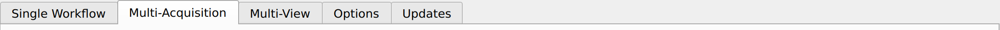
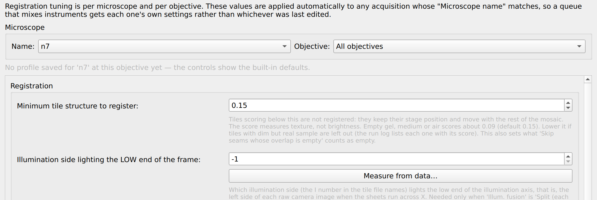

# Flamingo Stitcher

Standalone light-sheet tile **stitching** pipeline and GUI for Flamingo T-SPIM data.

It turns a folder of raw microscope tiles into a single stitched 3D volume you can
open in Fiji, napari, QuPath, or Imaris. You can run it **on any machine** — no
microscope and no full control software required. The *same code* also powers the
"Tile Stitching" menu inside [Py2Flamingo](https://github.com/uw-loci/Flamingo_Control),
so results match (single source of truth, no drift).

---

## Quick start (Windows, no Python needed)

If you just want to stitch a dataset, this is all you need.

### 1. Install

1. Go to the [Releases](../../releases) page.
2. Download the newest **`FlamingoStitcher-Setup-vX.Y.Z.exe`**.
3. Run it. (It's unsigned for now, so Windows SmartScreen may warn — click
   **More info → Run anyway**.)
4. Launch **Flamingo Stitcher** from the Start menu.

The app updates itself: the **Updates** tab checks for newer versions on launch and
offers a one-click install when one exists.

### 2. Stitch your first dataset

You'll see five tabs: **Single Workflow**, **Multi-Acquisition**, **Multi-View**,
**Options**, and **Updates**. The app opens on Single Workflow the first time and on
the tab you last used after that. For a first run you want one of the first two —
[Which tab?](#which-tab-do-i-use) tells you which, by looking at your folder. Then:

<!-- SCREENSHOT NEEDED -> docs/images/tabs.png
     Capture: the app window, the five tabs along the top clearly readable.
     Why: readers need to recognize the tab strip before they can choose.
     To publish it, drop the file in and uncomment the line below.

-->

1. **Add your data.** Click **Add…** and select your acquisition folder. (You can add
   several and stitch them back-to-back.)
2. **Click "Discover Tiles".** The app scans the folder and figures out the details
   for you. A line appears at the top of *"Tell me about your image"* showing what it
   detected — frame/ROI size, pixel size, Z step, channels, and tile count. **Glance at
   it to confirm it looks right.**
3. **Pick an output folder.** Click **Browse…** next to *Output Directory*. Each
   acquisition is saved into its own subfolder there.
4. **Click "Run All".** Progress shows at the bottom. When it finishes, open the
   result (an `..._stitched` folder) in Fiji or napari.

That's it. The default settings are chosen to work for typical Flamingo data — you
usually don't need to change anything in steps 2–3.

### Which tab do I use?

The tab names describe **how the microscope software wrote your files**, not anything
you chose at the scope. So open your acquisition folder and look at it:

| What you see in the folder | Use this tab | Why |
|---|---|---|
| Image files sitting loose in one folder, named `…_X000_Y000_C03_I0_…` | **Single Workflow** | The microscope's own control software writes every tile into one folder. This is the usual case, and where most people are. |
| One subfolder per tile, named for its stage position — `X4.00_Y12.00` | **Multi-Acquisition** | The Py2Flamingo layout. Also use this tab to queue several acquisitions and stitch them back to back. |
| Several acquisitions of one sample at different rotation angles | **Multi-View** | Fuses the angles into one volume. The rotation conventions are not yet confirmed on an instrument — check the result before trusting it. |

Tile files may be `.raw`, `.tif`, `.tiff` or `.btf` — the extension does not decide the
tab; the folder shape does.

The two layouts look more alike than you'd expect: a tile **file** is `X000_Y000`
(zero-padded counts) and a tile **folder** is `X4.00_Y12.00` (stage millimeters). If in
doubt, the test that settles it is whether the images are loose in the folder you
selected, or one level down inside per-tile subfolders.

<!-- SCREENSHOT NEEDED -> docs/images/layout-single-workflow.png
     Capture: Windows Explorer on a Single Workflow acquisition folder — loose
     image files with names like S000_t000000_V000_R0000_X000_Y000_C03_I0_D0_P00643.raw
     Why: this one picture answers the question faster than the table does.

-->

<!-- SCREENSHOT NEEDED -> docs/images/layout-multi-acquisition.png
     Capture: Windows Explorer on a Multi-Acquisition dataset — one subfolder per
     tile, named like X4.00_Y12.00, inside a date folder.
     Why: the contrast with the picture above is the whole decision.

-->

Still unsure? Add the folder and click **Discover Tiles**. **0 tiles** means the layout
doesn't match that tab — try the other one.

### The other two tabs

**Options** holds the registration settings, saved per microscope and objective, so a
value you tune once is reused by every future run from that instrument. You don't need
it for a first run. Go there when the registration report says seams were rejected, or
when you want to set which illumination side lights the left of the frame.

<!-- SCREENSHOT NEEDED -> docs/images/options-tab.png
     Capture: the Options tab with a microscope selected, controls visible.
     Why: nothing user-facing has ever documented this tab; people do not know it exists.

-->

**Updates** checks for a newer version on launch and installs it in one click.

---

## Understanding the settings

Each stitching tab has four parts. **For a first run you can leave the settings
alone.**

- **Acquisitions**: the queue. Each acquisition keeps its own settings; **Run All**
  stitches every Pending acquisition, **Run Selected** only the selected ones.
- **Basics**: what every run needs: **Downsample** (with the output voxel size,
  memory, size and time it implies shown right under it), **About the image**,
  **Saving**, and **Memory management** (memory mode, fusion chunk and region
  size, and the scratch folder for temporary files).
- **Image quality** tab: how the two light sheets are combined (and aligned),
  brightness (flat-field correction, intensity adjustment), stripes (destripe),
  sharpness (deconvolution) and background zeroing.
- **Registration and overlap** tab: where each tile goes (registration), how
  neighboring tiles are joined (tile overlap, content-based blending), and the
  checks and reports. **Hide settings** folds both tabs to give the log room; a run
  does this for the running acquisition.

<details>
<summary>The queue: settings per acquisition, the Settings letters, Run Selected, Cancel and the time left</summary>

Select a row, or several from one microscope and objective, to see and change
their settings. The **Microscope** column shows the microscope and objective each
acquisition was taken with. The **Settings** column gives each group of
acquisitions that share settings a letter: the first ones queued are Set A, an
acquisition from another microscope or objective starts Set B, and changing only
some rows of a set moves them to a new letter. Rows from different microscopes or
objectives cannot be changed together.

During a run the queue stays open: add acquisitions, or change a pending one's
settings; only the running acquisition's settings are locked. Only one stitch runs
at a time across the tabs. **Run All** stitches every Pending acquisition; **Run
Selected** only the selected ones. During a run the progress line gives the
running acquisition's time left, then the queue's (every acquisition still
waiting in this run, each priced with its own settings). **Cancel** stops the
running acquisition within a few seconds and cancels the rest of that run.

</details>

<details>
<summary>About the image: pixel size, Z step, frame and channels, and where the pixel size comes from</summary>

Pixel size, Z step, frame (camera ROI) and channels are filled in by *Discover
Tiles*; change one only if you know a detected value is wrong. Unless you set the
XY pixel size by hand, **each queued acquisition uses the pixel size implied by its
own objective** (from its `ScopeSettings.txt`), so a queue mixing objectives
stitches every item at the right scale. A typed value applies to the selected
acquisitions.

- **The pixel size is always shown in the log.** Discovery prints
  `Effective XY pixel size: … µm/px (the value stitching will use)`. If the
  tiles come out **spaced apart like dice**, this value is almost always wrong —
  check that line first.
- **Pick the right folder.** The objective is read from `ScopeSettings.txt`. If
  you select a parent folder whose acquisitions live in a dated subfolder, the
  app now searches down into it — but if it still can't find the objective it
  logs a ⚠ warning and falls back to the current (possibly wrong) pixel size.
- **Per-microscope fallback.** For systems that don't record the objective in
  `ScopeSettings.txt`, a per-microscope `objective_magnification` in
  `microscope_hardware.yaml` (`microscopes:` block) supplies it — e.g. `liara`
  (25.48×, measured on a calibration standard) → ~0.255 µm/px.

</details>

<details>
<summary>Saving: output formats, compression, TIFF pyramids</summary>

**Saving** holds the output format, compression, **TIFF pyramids** and **Package as
.ozx**. **OME-Zarr (Fiji compatible)** is a safe default.

- **Formats.** OME-Zarr (Fiji compatible) is Zarr v2 + OME-NGFF v0.4; OME-Zarr
  Sharded is Zarr v3 + OME-NGFF v0.5, which only napari and zarr-python 3.x read.
  OME-TIFF writes all channels into one `<name>.ome.tif`. Imaris (.ims) uses
  PyImarisWriter (Apache 2.0; `pip install "flamingo-stitcher[imaris]"`, Windows
  only), writes block by block so it scales to TB-sized output, and builds its own
  pyramids. It exists because ImarisFileConverter misreads OME-TIFF pyramid
  SubIFDs as extra Z planes and collapses the data into Z = 0; to use the
  converter anyway, write OME-TIFF with **TIFF pyramids** unchecked. Fiji and
  Imaris do not need TIFF pyramids; napari and QuPath zoom faster with them.
- **Compression.** None skips encoding and decoding, so it is fastest from a fast
  local SSD, at the cost of much larger files. Over network shares, USB or
  spinning disks, compressed files often load faster than uncompressed ones
  because the disk, not decoding, is the bottleneck. zstd and lz4 decode
  quickly; zlib and lzw are the TIFF codecs older software reads. zstd for TIFF
  is only offered when the `imagecodecs` package is installed.

</details>

Under the tabs, **This run** lists what the selected acquisition's run will do, as
tags: orange for slow options, red for lossy ones, yellow for skipped or unused.

Parts installed once per computer (flat-field correction, deconvolution, and the
live background-zeroing preview) are on the **Options** tab under **Optional
components**. A control that waits on one of them says so and links there.

> Tip: hover over any control to get a tooltip explaining it. Open the **Log** panel
> (collapsed at the bottom) to see full detail of what was detected and done.

If you hit trouble (out-of-memory, a run that seems stuck, slow stitching), click
**Help / Troubleshooting** in the app, or see
[`stitching_hardware_troubleshooting.md`](src/flamingo_stitcher/docs/stitching_hardware_troubleshooting.md).

---

## Getting the tiles to connect (camera orientation)

**Every microscope must have its tile orientation chosen once.** Different
Flamingos mount the camera differently, so there is no safe default — the first
time you stitch data from a microscope the app has not seen, it **stops and asks
you to pick the orientation** (rather than guess and silently mis-place tiles).
Once chosen, it's remembered for that microscope and applied automatically. If a
dataset has no image data to preview from (no per-tile MIPs and no readable raw
stacks), the app tells you it can't determine the orientation and that you need a
dataset that includes MIPs for that microscope.

<details>
<summary>How to pick the orientation in 'Orientation Preview…'</summary>

To pick it — fix it visually, no config editing:

1. Add your acquisition and click **Discover Tiles**.
2. Click **Orientation Preview…**. It shows the mosaic under all 8 tile
   orientations (built quickly from the per-tile MIP files) — each panel
   re-orients *every tile* and re-tiles at the stage grid.
3. If scattered beads hide the real structure, narrow the **Z projection**
   (e.g. *Bottom 25%*) — structure often lives in part of the stack.
4. If the tiles are laid out **backwards** (X3 X2 X1 X0 instead of X0 X1 X2 X3),
   tick **Reverse X order** / **Reverse Y order** — this is separate from the
   panel choice (a system can need a flip in X but a reversed order in Y).
5. Select the panel where the tissue is **continuous across the seams**, then
   click **Use for stitching**.

Your choice is applied to the run **and remembered for that microscope** (by its
name in the acquisition metadata), so future data from the same system picks it
up automatically. Orientation is resolved **per acquisition** at run time from
each item's own microscope name, so a batch mixing systems orients each one
correctly (a choice made for one scope never touches another). The effective
orientation is printed in the log at the start of every run. Command line:
`--tile-orientation NAME [--reverse-x-tiles] [--reverse-y-tiles]`.

</details>

<details>
<summary>Orientation names for the command line and config files</summary>

`NAME` is the stored value (also used in config files); the preview panels show the label:

| `NAME` | Panel label |
|---|---|
| `identity` | As captured (no change) |
| `rot90` | Rotate 90° counter-clockwise |
| `rot180` | Rotate 180° |
| `rot270` | Rotate 90° clockwise |
| `flip_h` | Mirror left–right |
| `flip_v` | Mirror top–bottom |
| `transpose` | Swap X and Y (mirror across the main diagonal) |
| `anti_transpose` | Mirror across the other diagonal |

</details>

## Re-running to the same folder

Re-stitching the same data with the same settings would overwrite the previous
result. The app now **asks first** — *Overwrite*, *New folder* (writes a
numbered copy, keeping the old one), or *Skip* — with an "apply to all remaining"
option for batches. Runs with *different* settings already get distinct
filenames and coexist. Command line: `--if-exists {overwrite,skip,unique}`.

## Corrupt or incomplete tiles

If a tile's metadata or image file can't be read (a flaky USB drive, a truncated
`.raw`), discovery no longer throws away the whole acquisition — it estimates
that tile's position from the acquisition grid and keeps going, then shows a
**"Data-quality warnings"** summary so you know which tiles may be off before you
trust the result.

---

## What the run writes

Each acquisition gets its own `..._stitched` folder containing:

| File | What it is |
|---|---|
| `<name>.ome.tif` / `.ome.zarr` / `.ims` | the stitched volume |
| `stitch_metadata.json` | the record worth keeping. Software version and git hash, voxel size, channels, tile count, every per-tile position, the world frame, and every processing setting the run used |
| `registration_report.txt` | the human summary — read this first |
| `registration_report.csv` | one row per tile: the correction applied, in µm |
| `registration_seams.csv` | one row per expected neighbor pair, and what became of it |

<details>
<summary>Reports from earlier runs, and the world frame in stitch_metadata.json</summary>

Stitching the same acquisition twice with different settings also writes a
second copy of each report under a name carrying those settings
(`..._flatfield_registration_report.csv`), so a later run cannot overwrite an
earlier run's evidence. The plain names always hold the most recent run.

`stitch_metadata.json` carries a `world_frame` block. Read it before converting
stitched coordinates back to stage coordinates — some acquisitions negate world
X, so an origin can legitimately be a large negative number, and treating it as
a stage coordinate places the volume mirrored and displaced.

</details>

## Reusing a setup on another machine

Tune a stitch once, then apply exactly that treatment to more datasets — on the
microscope computer, or on your own laptop.

- **Save Configuration…** writes the current settings to a file.
- **Load Configuration…** reads one back, or reads the `stitch_metadata.json`
  from any finished run.

<details>
<summary>What a saved configuration carries, and what it leaves out</summary>

It carries everything that shapes the output: processing options, destripe
tuning, deconvolution parameters, registration thresholds, border QC.

It deliberately does not carry pixel size, Z spacing or frame size — Discover
measures those from your own data — nor the machine's memory ceiling, worker
counts or scratch path. A PSF file is used only if that file exists on your
machine, and the app says so plainly when it doesn't.

</details>

## Limitations, and when not to trust the result

Stitching can succeed on part of a mosaic and fail on the rest. Several gates
exist to stop a half-registered result being presented as a good one. When one
fires, tiles are placed by their recorded stage positions instead, and the
registration report names which gate fired and for which tiles.

<details>
<summary>The registration gates and their defaults, and two further limits</summary>

| Gate | Default | What it means when it fires |
|---|---|---|
| Minimum tile overlap to attempt registration | 5% of a frame | Too little shared content to measure a shift |
| Minimum share of seams that must register | 50% | Not enough of the mosaic agreed; the whole result falls back to stage positions |
| Minimum tile structure | 0.15 | A tile has nothing to align on — empty medium, or bright but featureless gel |
| Seam quality threshold | 0.4 | That seam's correlation was too weak to believe |
| Maximum lateral / axial correction | auto | A proposed shift was larger than the geometry allows |

Two further limits:

- **Multi-view rotation is not instrument-validated.** The rotation sign and
  center conventions are checked on synthetic data only. Verify with a two-angle
  test acquisition, and flip the sign if the views come out mirrored.
- **Tile-to-tile brightness is evened out only when 'Intensity adjustment' is
  set to 'Apply'** (Image quality tab). It fits a gain and offset per tile from
  the overlaps, so a tile that really was brighter is dimmed to match its
  neighbors. Flat-field correction addresses the illumination profile within a
  tile, not tile-to-tile differences.

<!-- SCREENSHOT NEEDED -> docs/images/registration-report.png
     Capture: registration_report.txt open in a text editor, the seam summary
     line visible ("Seams: N registered · N pruned · ...").
     Why: users are told to read this file and have never been shown one.

-->

</details>

## Methods and how to cite

<details>
<summary>Algorithms to name in a methods section, and how to cite the software</summary>

Registration and fusion are performed by
[multiview-stitcher](https://github.com/multiview-stitcher/multiview-stitcher).
Two of its algorithms are the ones a methods section should name:

- **Global optimization with iterative edge pruning**, and **cosine-weighted
  blending** across tile overlaps — after BigStitcher: Hörl et al., *BigStitcher:
  reconstructing high-resolution image datasets of cleared and expanded samples*,
  Nature Methods 16, 870–874 (2019).
- **Content-based fusion weighting** — Preibisch et al., local-variance weighting
  of each tile's contribution in overlap regions.

Flat-field correction uses [BaSiCPy](https://github.com/peng-lab/BaSiCPy);
destriping uses a vendored copy of the pystripe wavelet filter.

To cite the software itself, see `CITATION.cff` in the repository root.

</details>

## For developers / Python users

<details>
<summary>Installing with pip, optional backends, deconvolution, the GUI and CLI commands</summary>

```bash
pip install "flamingo-stitcher[gui]"        # CLI + GUI (PyQt5, no napari)
pip install "flamingo-stitcher[gui,preview]" # + napari background-zero preview
```

Optional backends:

```bash
pip install "flamingo-stitcher[imaris]"    # direct .ims output (Windows only)
pip install "flamingo-stitcher[destripe]"  # destriping (vendored filter + PyWavelets)
pip install "flamingo-stitcher[deconv]"    # RedLionfish GPU deconvolution (OpenCL)
conda install -c conda-forge pycudadecon   # NVIDIA GPU deconvolution
```

Deconvolution is Richardson-Lucy, run by pycudadecon (NVIDIA, CUDA) or RedLionfish
(OpenCL). Its engine, iteration count (default 10) and PSF are set in the
`deconvolution:` block of `stitching_config.yaml`: `psf_path` names a measured PSF
file; otherwise one is calculated from the objective NA and immersion index in
`microscope_hardware.yaml` and one wavelength for all channels (default 488 nm).

Leonardo FUSE illumination fusion needs its own GPU environment, which the in-app
*Set up flat-field…* install does not include; `scripts/create_preprocessing_env.sh`
(or `.bat`) builds one with leonardo-toolset.

GUI:

```bash
flamingo-stitch-gui
```

CLI:

```bash
flamingo-stitch /path/to/acquisition -o /path/to/output \
    --pixel-size-um 0.406 --output-format ome-zarr-sharded
flamingo-stitch /path/to/acquisition --dry-run     # list discovered tiles
flamingo-stitch --help
```

It converts raw acquisition folders into stitched volumes using
[multiview-stitcher](https://github.com/multiview-stitcher/multiview-stitcher) for
registration and fusion, and writes OME-Zarr, OME-TIFF, or Imaris `.ims`.

</details>

## Dependencies

<details>
<summary>Core dependencies and the dask version range</summary>

Core (always installed): `numpy`, `scipy`, `dask[array]`, `zarr`, `numcodecs`,
`multiview-stitcher`, `ngff-zarr`, `tifffile`, `psutil`, `PyYAML`.
The `dask` version range excludes 2025.12.0–2026.3.0 (they break ngff-zarr's
OME-Zarr v0.4 writes; see forum.image.sc topic 120480).

</details>

## License

**GNU General Public License v3.0 or later** (GPL-3.0-or-later) — see [`LICENSE`](LICENSE).

The GUI uses **PyQt5** (GPL-3.0), which the Windows installer bundles, making the
distributed binary GPL-3.0. Every other dependency is permissive (BSD-3-Clause /
MIT / Apache-2.0) and GPL-compatible. This project is derived from
[Py2Flamingo](https://github.com/uw-loci/Flamingo_Control) (MIT); see
[`NOTICE`](NOTICE) for full third-party attribution and
[`LICENSE_ANALYSIS_TODO.md`](LICENSE_ANALYSIS_TODO.md) for the analysis (incl. the
PySide6/MIT alternative).
